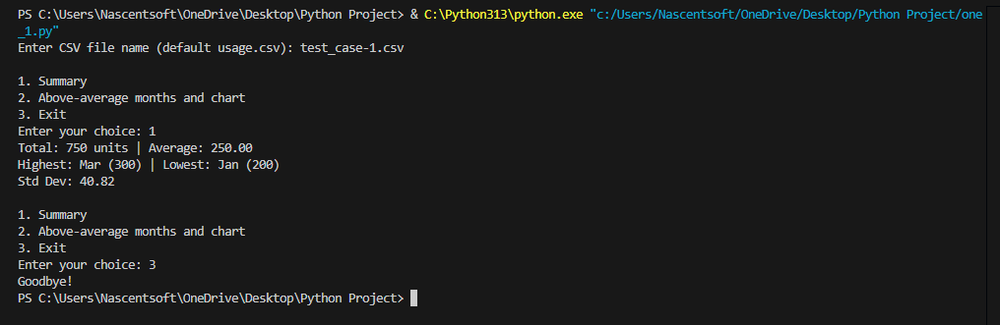
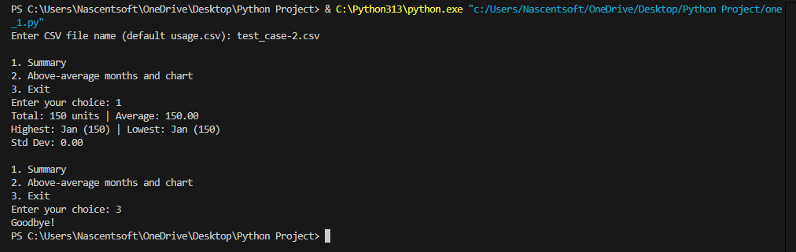
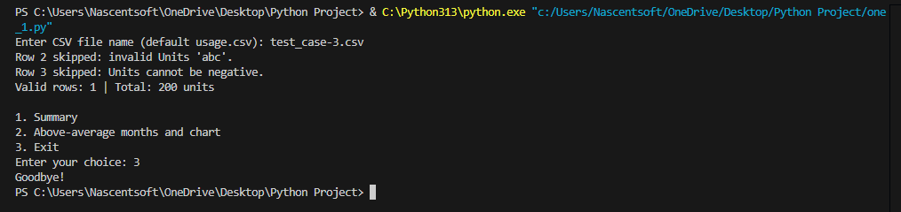
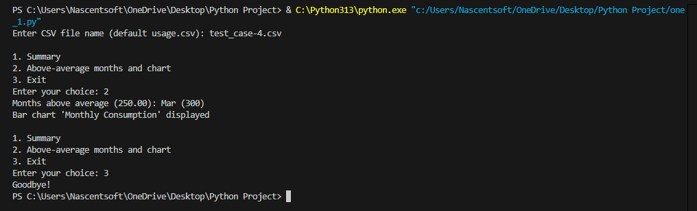
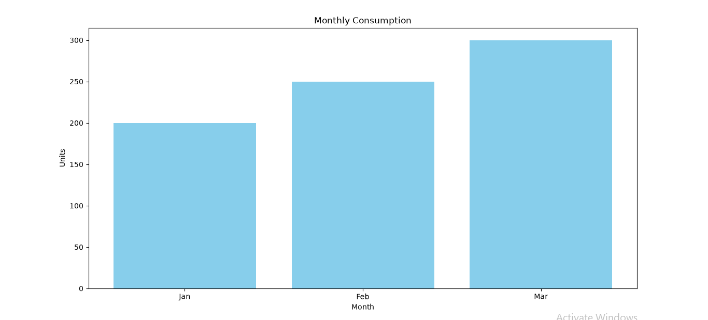
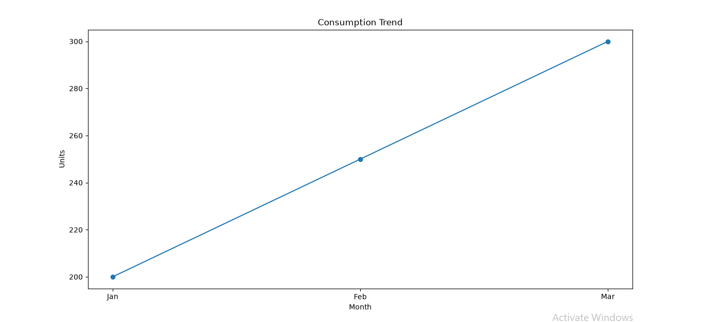

# Project Summary - Electricity Consumption Analyzer

## 1. Problem Statement
Analyse monthly electricity consumption from a CSV file using NumPy and Pandas. Find the total and average usage, the highest and lowest months, and the months above average. Then show the trend using charts.

## 2. How I Implemented It

**Step 1: Reading the file**
The program asks for a CSV file name (default `usage.csv`) and loads it with Pandas (`pd.read_csv`). If the file is not found, it shows an error message.

**Step 2: Cleaning the data**
A `for` loop checks every row:
- If Units is not a number (like `abc`), the row is skipped.
- If Units is negative, the row is skipped.
- Valid rows are saved in a clean table (DataFrame).

**Step 3: Calculations using NumPy**
- `np.sum` for total
- `np.mean` for average
- `np.max` and `np.min` for highest and lowest
- `np.std` for standard deviation

**Step 4: Above-average months**
Boolean filtering is used: `df[df["Units"] > average]` keeps only the rows with units above the average.

**Step 5: Charts using Matplotlib**
- A bar chart titled "Monthly Consumption"
- A line chart showing the trend
Both have a title and axis labels.

**Step 6: Menu**
A `while` loop shows the menu: 1 Summary, 2 Above-average months and chart, 3 Exit.

## 3. Test Cases

### Test Case 1: Normal Input
Input: Jan,200 / Feb,250 / Mar,300 (Menu option 1)

Expected output: Total 750 units, Average 250.00, Highest Mar (300), Lowest Jan (200), Std Dev 40.82

### Test Case 2: Boundary / Minimum Input
Input: Jan,150 (one row only, Menu option 1)

Expected output: Total 150 units, Average 150.00, Highest Jan (150), Lowest Jan (150), Std Dev 0.00

### Test Case 3: Invalid Input
Input: Jan,200 / Feb,abc / Mar,-30

Expected output: Row 2 skipped: invalid Units 'abc'. Row 3 skipped: Units cannot be negative. Valid rows: 1, Total: 200 units

### Test Case 4: Different Valid Scenario
Input: same CSV as Test Case 1 (Menu option 2)

Expected output: Months above average (250.00): Mar (300). Bar chart 'Monthly Consumption' displayed.

## 4. Challenges Faced
- Libraries were not installed at first, so I installed them with `pip install numpy pandas matplotlib`.
- I had to keep the CSV and Python file in the same folder so the program could find the file.

## 5. Conclusion
The program reads electricity data, handles invalid input, calculates the required statistics and shows the trend with charts. It passes all 4 test cases.